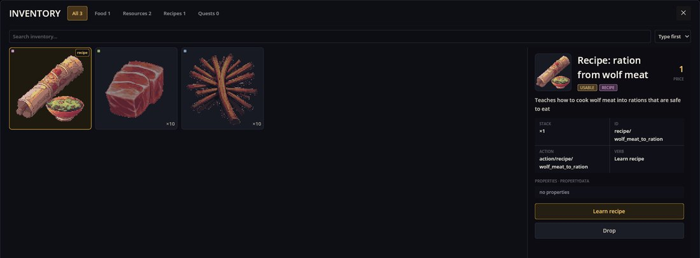
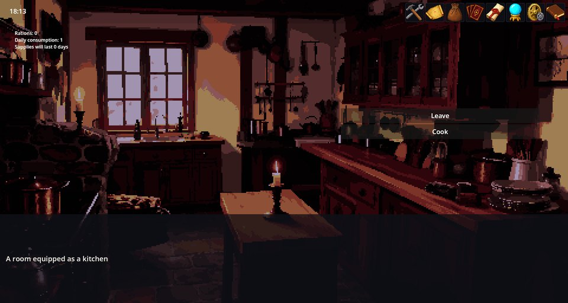
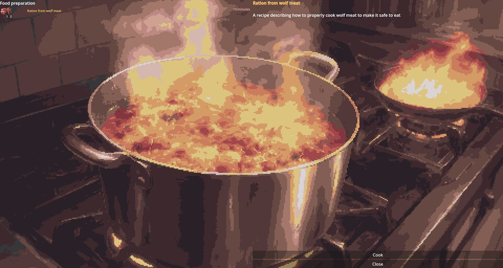
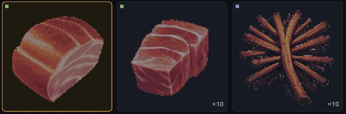

# Cooking — кухня Cthangover

Cooking — это кухня дома в Cthangover: игрок изучает рецепты по предметам-рецептам, готовит на кухонном верстаке и следит, на сколько дней хватит отряду пайков. Это механика игры Cthangover — она открывается в сцене `home_kitchen` и использует предметы этой игры — и это не то же самое, что Crafting, универсальный верстак из RPG Plus (сравнение — ниже).

## Изучение рецепта

Рецепты приходят в виде предметов. Выберите такой предмет в сумке и нажмите **Изучить рецепт**; предмет тратится, а рецепт становится известен:



## Кухня

На кухне сюжет спрашивает, что делать. Маленькая панель слева вверху считает пайки:



- **Пайки** — сколько их лежит в сумке.
- **Потребление в сутки** — персонажи в отряде × сколько пайков съедает каждый за день (настройка мода, по умолчанию 1).
- **Запасов хватит** — на сколько целых дней хватит пайков.

Кнопка **Готовить** открывает верстак поверх кухонной картинки. Слева перечислены известные рецепты готовки — ингредиенты с количествами, название и время — а выбранный рецепт описан справа:



Щёлкните рецепт и нажмите **Готовить**. Если в сумке есть ингредиенты, они тратятся, продукты добавляются, часы уходят вперёд на время рецепта и звучит звук готовки. Рецепты, которые можно приготовить прямо сейчас, стоят в списке первыми.

После приготовления одного пайка из одного волчьего мяса и двух веток:



## Данные

Рецепт:

```json
{
  "Kind": "recipe",
  "Items": [
    {
      "Id": "recipe/wolf_meat_to_ration",
      "Name": "recipe/wolf_meat_to_ration/name",
      "Description": "recipe/wolf_meat_to_ration/desc",
      "Type": "Cooking",
      "Time": 15,
      "Input": [ { "Id": "food/wolf_meat", "Count": 1 }, { "Id": "resource/branches", "Count": 2 } ],
      "Output": [ { "Id": "food/ration", "Count": 1 } ]
    }
  ]
}
```

и предмет, который его обучает:

```json
{ "Id": "recipe/wolf_meat_to_ration", "ItemType": "Recipe,Used", "ItemAction": "action/recipe/wolf_meat_to_ration" }
```

Верстак показывает только изученные рецепты типа `Cooking`. Предметное действие, обучающее этому рецепту, — это код в моде (один класс на рецепт).

Сценарий кухни:

```scenario
scene: home_kitchen
priority: 5
---
select "Комната оборудованная под кухню" key=rooms/kitchen/prompt
option "Выйти" key=rooms/kitchen/opt_exit -> :exit
option "Готовить" key=rooms/kitchen/opt_cook -> :cook

:cook
action toggle_cooking_workbench
end
```

## Cooking и Crafting

- **Cooking** показывает изученные рецепты — с типом `Cooking` — на полноэкранном кухонном верстаке; открывается действием `toggle_cooking_workbench`; относится к Cthangover и считает пайки.
- **Crafting** показывает рецепты, которые перечисляет *станция*, без какого-либо изучения; любая игра открывает любую станцию командой `craft.open station=…`; ингредиенты и продукты проверяются до того, как будет взято что-либо.

Оба берут ингредиенты из сумки, выдают продукты и переводят часы на `Time` рецепта.

## Если что-то пошло не так

1. **Верстак пуст.** Ни один рецепт готовки ещё не изучен — сначала используйте предмет-рецепт из сумки.
2. **«Готовить» ничего не делает.** Рецепт не выбран или не хватает какого-то ингредиента.
3. **Пайки нельзя съесть.** У пайка нет предметного действия; панель только считает, на сколько хватит запасов, и сама по себе ничего их не съедает.
